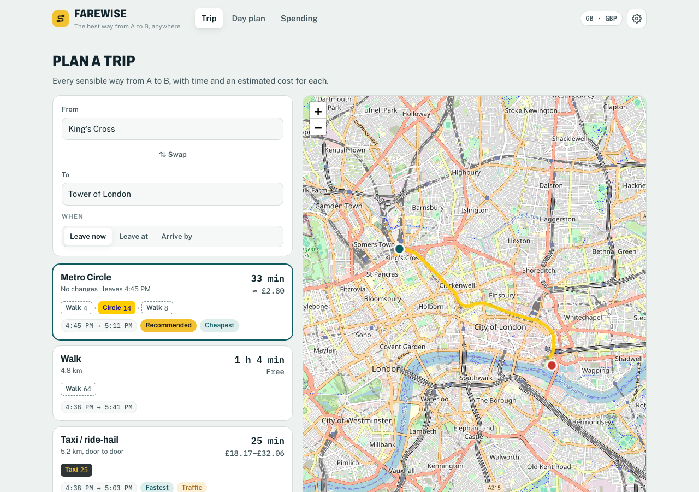
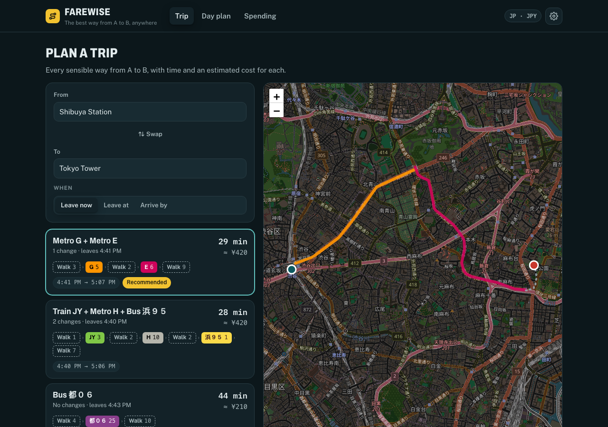

# Farewise

**The best way from A to B, anywhere.** Enter where you're starting and where you're going, and Farewise compares walking, cycling, public transit, taxis and driving, each with a time and an estimated cost. It also plans a day of several stops around fixed times and keeps track of what you spend getting around.

### 👉 [Open Farewise: advk2k4.github.io/farewise](https://advk2k4.github.io/farewise/)

No sign-up, no API keys, no tracking. It runs in your browser on phone or laptop.



---

## Features

### 🧭 Trip: every way from A to B
- **Search any address or place worldwide**, or use your current location. Recent places and your home are one tap away.
- **Compares walking, cycling, public transit, taxi / ride-hail and driving.** Transit uses real timetables (live where operators share it), with line names and colours, changes and walking time.
- **Leave now, Leave at or Arrive by.**
- **Recommended, Cheapest and Fastest** tags, weighted by whether you'd rather save money, save time or balance the two.
- **Estimated prices** in local currency for 50 countries, all adjustable.
- **A map** of the selected route, **step-by-step directions**, an **Open in Google Maps** button for live traffic, and **shareable links** to any trip.

### 🗓️ Day plan: several stops, one day
- Add stops, give any of them a **fixed time** (a meeting, a booking, a class) and set how long you'll stay.
- Each leg gets the best way to travel; change any of them. The plan shows when you'll arrive, flags **On time / Tight / Late**, and offers a faster option when you'd be late.
- **Best visit order** keeps fixed times in sequence and fits the rest in where they add the least travel.
- Totals for travel time, cost and finish time, plus how the day compares to your budget. Log the whole day in one tap.


### 💸 Spending: what getting around costs you
- Log trips from Trip or Day plan with one tap, or add expenses by hand, then edit amounts to what you actually paid.
- An optional **budget per cycle**, with the cycle starting on any day of the month (handy for payday or an employer's travel allowance).
- **Per-day allowance**, **cycle-end pace**, a spending chart and a breakdown by mode.

### 🌗 Also
- Light and dark themes, a layout that works on phones, keyboard-friendly place search.
- Your data stays in your browser; a **backup code** moves it to another device.

<p align="center"></p>

---

## How it works

Farewise is a static site that talks directly to free, open services:

| | Service |
|---|---|
| Search | [Photon](https://photon.komoot.io) (OpenStreetMap) |
| Walking, cycling, driving | [OSRM by FOSSGIS](https://routing.openstreetmap.de/about.html) |
| Public transit | [Transitous](https://transitous.org) (MOTIS 2, community-run) |
| Map | [Leaflet](https://leafletjs.com) + [OpenStreetMap](https://www.openstreetmap.org/copyright) tiles |

It asks all of them at once, prices each option from local rates, and ranks the options with one score: minutes + price (scaled so that **one local transit fare ≈ 10 minutes** when balanced) + small penalties for changes and long walks.

Full details, including the traffic model, pricing and scoring, are in **[docs/how-it-works.md](docs/how-it-works.md)**.

> **Coverage note:** transit is only as good as the open timetable data. It works in many cities across Europe, North America, East Asia, Australia and South America, but some regions (for example most of India and the Gulf) have no open transit data yet. There, Farewise shows walking, cycling, taxi and driving, and links to Google Maps for transit.

---

## Run it locally

```bash
git clone https://github.com/Advk2k4/farewise.git
cd farewise
python3 scripts/serve.py        # → http://localhost:8766
```

No install or build step is needed for development. To produce the single-file build that gets deployed:

```bash
python3 scripts/build.py        # → dist/index.html
```

Every push to `main` builds and deploys to GitHub Pages through [`.github/workflows/pages.yml`](.github/workflows/pages.yml).

## Project structure

```
farewise/
├── src/
│   ├── index.html            page shell + script load order
│   ├── styles/app.css        design tokens (light/dark), layout, components
│   └── js/
│       ├── core/             formatting, dates, distance, polyline decoding
│       ├── data/rates.js     default prices for 50 countries
│       ├── services/api.js   Photon, OSRM and Transitous clients (+ cache)
│       ├── engine/           builds, prices, scores and tags options
│       ├── state/            app state, storage, backup codes, spending cycles
│       └── ui/               one file per view + map + shared components + app shell
├── scripts/
│   ├── serve.py              local dev server
│   └── build.py              bundle src/ into dist/index.html
├── docs/
│   ├── how-it-works.md       data sources, options, prices, ranking
│   ├── architecture.md       code layout, rendering, storage, URLs
│   └── screenshots/
└── .github/workflows/pages.yml
```

## Contributing

**Better default prices are the most useful contribution.** They live in [`src/js/data/rates.js`](src/js/data/rates.js), one line per country. Bug reports and pull requests are welcome.

## Fair use of the free services

Farewise depends on volunteer-run infrastructure, so it caches responses and only routes when both ends of a trip are set. If you fork it, please follow each service's terms:
- **Transitous:** open source, non-commercial, attribution required, and heavy use (>720 route searches a day) must be coordinated with them.
- **Photon, FOSSGIS and OpenStreetMap tiles:** fair use with attribution.

Consider [donating to Transitous](https://transitous.org/donate/).

## Limitations

- Prices are estimates from typical local rates, not quotes. Passes, free transfers, zones and surge pricing aren't modelled.
- Driving times use a typical-traffic multiplier, not live traffic.
- Transit coverage depends on open timetable data (see the coverage note above).

## License

[MIT](LICENSE) © 2026 Aadvik Mishra. Map data © OpenStreetMap contributors. Transit data © the [Transitous sources](https://transitous.org/sources/).
