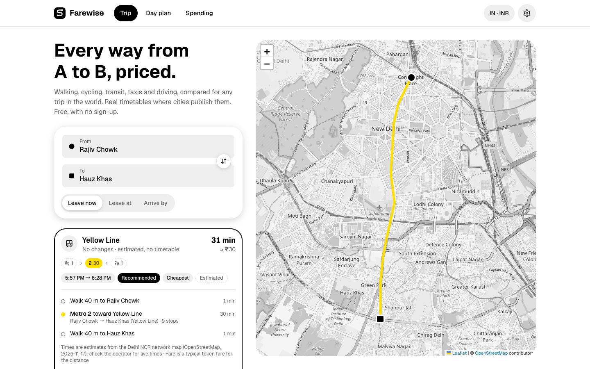
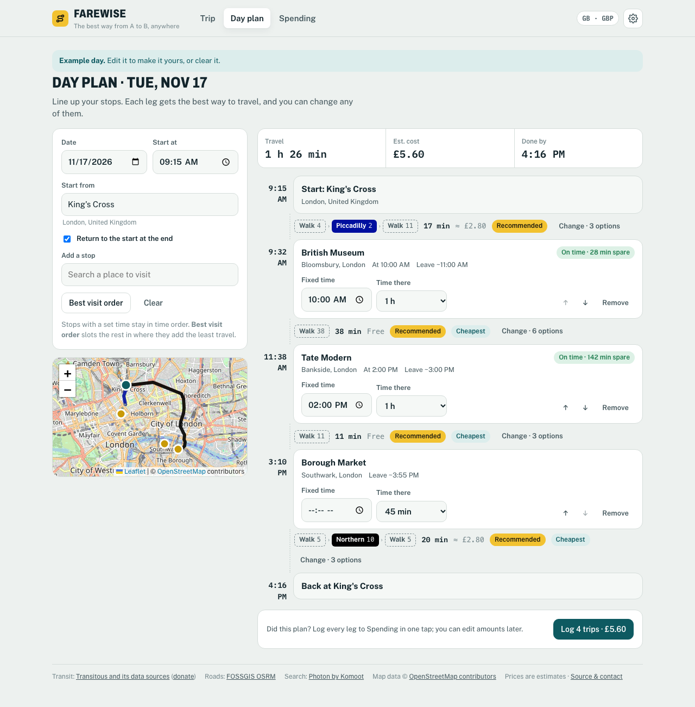
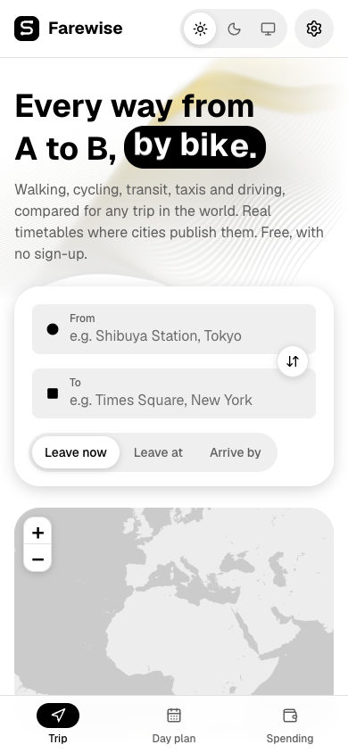

# Farewise

**Every way from A to B, priced.** Enter where you're starting and where you're going, anywhere in the world, and Farewise compares walking, cycling, public transit, taxis and driving, each with a time and an estimated cost. It also plans a day of several stops around fixed times and tracks what getting around costs you.

### 👉 [Open Farewise: advk2k4.github.io/farewise](https://advk2k4.github.io/farewise/)

Free, no sign-up, no API keys. It works on phone and laptop, with a light, dark or match-device theme.

<a href="https://advk2k4.github.io/farewise/launch/farewise-launch.mp4">
  
</a>

<p align="center"><b><a href="https://advk2k4.github.io/farewise/launch/farewise-launch.mp4">▶ Watch the 20-second launch video with sound</a></b></p>

---

## Features

### 🧭 Trip


- **Search any address or place worldwide**, or use your current location; home and recent places are one tap away.
- **Walking, cycling, public transit, taxi / ride-hail and driving**, side by side. Transit uses real timetables (live where operators share them), with line names and colours, changes and walking time.
- **Leave now, Leave at or Arrive by.**
- **Recommended, Cheapest and Fastest** tags, weighted by whether you'd rather save money, save time or balance the two.
- **Prices switch automatically** to the country and currency of the trip, from ballpark rates for 50 countries that you can adjust.
- **Metro and local trains even where live data is thin.** For 12 Indian cities (Delhi, Mumbai, Bengaluru, Chennai, Kolkata, Hyderabad and more), the rail networks are bundled from OpenStreetMap and routed offline with estimated times. Auto rickshaws appear where they're a normal way to get around.
- A **map** of the selected route, **step-by-step directions**, **Open in Google Maps** for live traffic, and **shareable links**: every trip lives in the URL.



### 🗓️ Day plan
- Add stops, give any of them a **fixed time**, and set how long you'll stay.
- Each leg gets the best way to travel; change any of them. Arrivals are flagged **On time / Tight / Late**, with a faster option offered when you'd be late.
- **Best visit order** keeps fixed times in sequence and fits the rest in where they add the least travel.
- Totals for travel time, cost and finish time; log the whole day in one tap.



### ✨ Feels alive
- The home screen shows **how it works before you type**: beams run from *From* through every mode to *To*, and a headline word cycles through the ways you could go. Example trips scroll past, ready to tap.
- Routes **draw themselves onto the map**, the start point pulses, and the recommended option has a slow travelling border.
- Logging a trip ends with a **small burst of confetti**; the Day plan timeline **fills as you scroll**, and Spending shows a **budget ring**.
- All of it stops under *Reduce motion*.

### 🌗 Light and dark
- Switch between **Light, Dark and Match device** from the header or Settings; your choice is remembered.
- Both themes are tuned together: line colours stay visible on either background, the map follows the theme, and all text meets WCAG AA contrast.

### 💸 Spending
- Log trips from Trip or Day plan in one tap, or add expenses by hand, then edit amounts to what you actually paid.
- An optional **budget per cycle**, with the cycle starting on any day of the month (handy for payday or a travel allowance).
- **Per-day allowance**, **cycle-end pace**, a spending chart and a breakdown by mode.

<p align="center">
  
  &nbsp;
  
</p>

---

## How it works

Farewise is a static web app that talks directly to free, open services:

| | Service |
|---|---|
| Search | [Photon](https://photon.komoot.io) (OpenStreetMap) |
| Walking, cycling, driving | [OSRM by FOSSGIS](https://routing.openstreetmap.de/about.html) |
| Public transit | [Transitous](https://transitous.org) (MOTIS 2, community-run) |
| Map | [Leaflet](https://leafletjs.com) + [OpenStreetMap](https://www.openstreetmap.org/copyright) tiles |

It queries them all at once, prices each option from local rates, and ranks the options with a single score: minutes + price (scaled so that **one local transit fare ≈ 10 minutes** when balanced) + small penalties for changes and long walks. Details: **[docs/how-it-works.md](docs/how-it-works.md)**.

> **Coverage:** live transit comes from open timetable data, which covers much of Europe, North America, East Asia, Australia and South America. Where it's thin, Farewise falls back to bundled metro and suburban-rail maps (12 Indian cities so far; `node scripts/fetch-networks.mjs` adds more), and otherwise links to Google Maps for transit.

## Built with

**React 19 · TypeScript · Vite · Tailwind CSS v4 · shadcn/ui (Radix) · Motion · Magic UI · React Bits · Leaflet**

A few effects are adapted from [Magic UI](https://magicui.design) (animated beams, border beam, marquee, progress ring), [React Bits](https://reactbits.dev) (Threads, Rotating Text) and [Aceternity UI](https://ui.aceternity.com) (the idea behind the timeline beam and the cycling search hints). Confetti is [canvas-confetti](https://github.com/catdad/canvas-confetti).

The design follows [`DESIGN.md`](DESIGN.md), a black-and-white mobility design system from [awesome-claude-design](https://github.com/VoltAgent/awesome-claude-design). It was shaped with the [Taste Skill](https://github.com/Leonxlnx/taste-skill), audited against the [Vercel Web Interface Guidelines](https://github.com/vercel-labs/web-interface-guidelines), and tested in a real browser with [Playwright](https://github.com/microsoft/playwright-cli). See **[docs/design.md](docs/design.md)**.

## Run it locally

```bash
git clone https://github.com/Advk2k4/farewise.git
cd farewise
npm install
npm run dev        # → http://localhost:5173
```

`npm test` checks the budget-cycle and undo logic. `npm run build` type-checks and builds to `dist/`. Every push to `main` deploys to GitHub Pages through [`.github/workflows/pages.yml`](.github/workflows/pages.yml).

## Project structure

```
farewise/
├── DESIGN.md                 the design system the UI is built on
├── index.html
├── src/
│   ├── App.tsx               shell: nav, tabs, footer, toasts
│   ├── index.css             Tailwind + light/dark design tokens
│   ├── lib/                  typed, framework-free logic
│   │   ├── api.ts            Photon, OSRM and Transitous clients (+ cache)
│   │   ├── options.ts        builds, prices, ranks and tags options
│   │   ├── rates.ts          default prices for 50 countries
│   │   ├── budget.ts         spending cycles and pace
│   │   ├── store.ts          local data + tiny external store
│   │   └── format.ts         time, money, distance, polylines
│   ├── components/           PlaceInput, OptionCard, RouteMap, HowItWorks, fx/ (React Bits), ui/ (shadcn + Magic UI)
│   └── views/                TripView, PlanView, SpendingView, SettingsView
├── public/networks/          bundled metro / local-train networks (OpenStreetMap)
├── public/launch/            launch video, poster and README preview
├── scripts/fetch-networks.mjs  refresh those networks from Overpass
├── docs/
│   ├── how-it-works.md       data sources, options, prices, ranking
│   ├── architecture.md       code layout, state, URLs, build
│   ├── design.md             design direction, colour rules, audit, testing
│   └── screenshots/
└── .github/workflows/pages.yml
```

The original no-build vanilla JavaScript version is tagged [`v1-vanilla`](https://github.com/Advk2k4/farewise/tree/v1-vanilla).

## Contributing

**Better default prices are the most useful contribution.** They live in [`src/lib/rates.ts`](src/lib/rates.ts), one line per country. Bug reports and pull requests are welcome.

## Fair use of the free services

Farewise depends on volunteer-run infrastructure, so it caches responses and routes only once both ends of a trip are set. If you fork it, follow each service's terms:
- **Transitous:** open source, non-commercial, attribution required, and heavy use (>720 route searches a day) must be coordinated with them.
- **Photon, FOSSGIS and OpenStreetMap tiles:** fair use with attribution.

Consider [donating to Transitous](https://transitous.org/donate/).

## Limitations

- Prices are estimates from typical local rates, not quotes. Passes, free transfers, zones and surge pricing aren't modelled.
- Driving times use a typical-traffic multiplier, not live traffic.
- Transit coverage depends on open timetable data.

## License

[MIT](LICENSE) © 2026 Aadvik Mishra. Map and network data © OpenStreetMap contributors (ODbL). Transit data © the [Transitous sources](https://transitous.org/sources/). Not affiliated with Uber; `DESIGN.md` is a community interpretation of its public design language.
